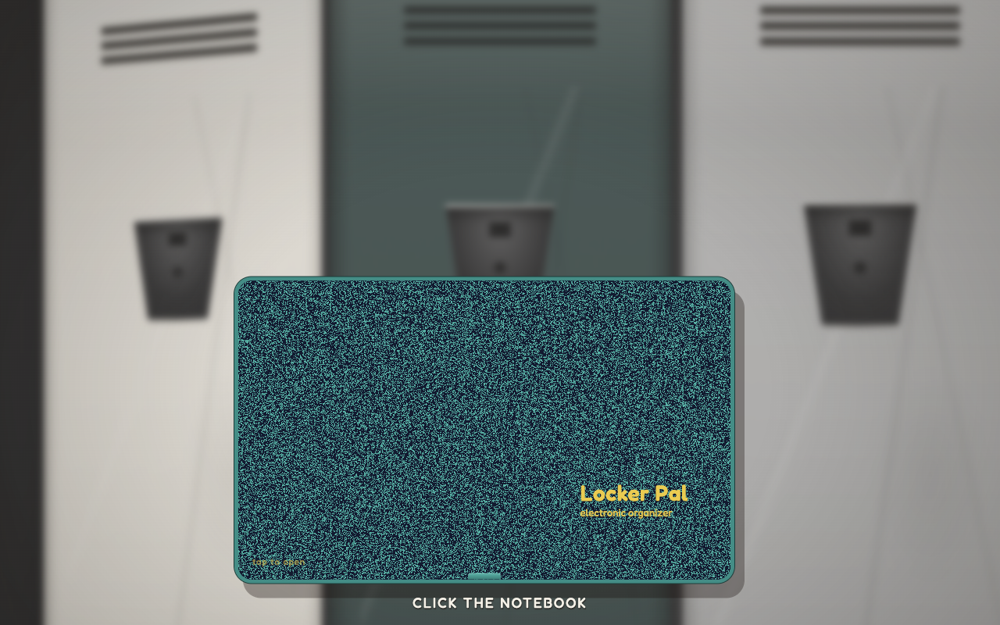
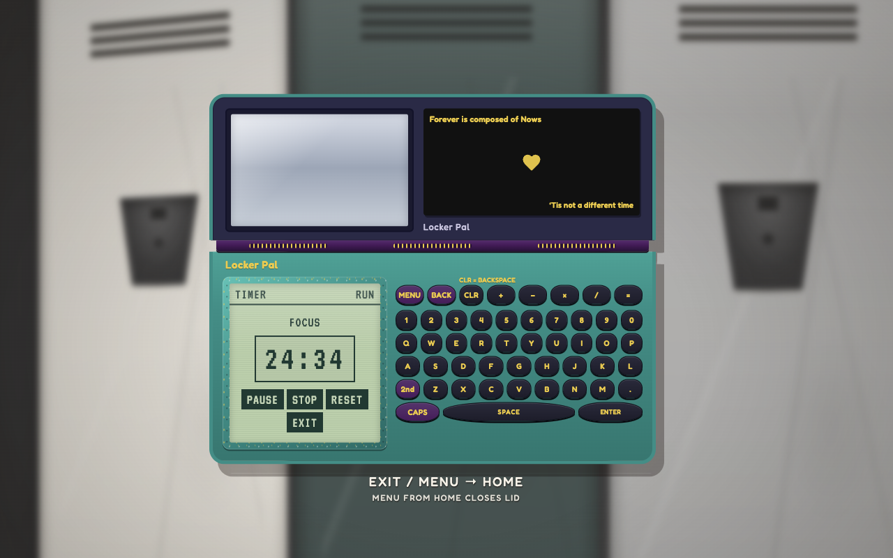
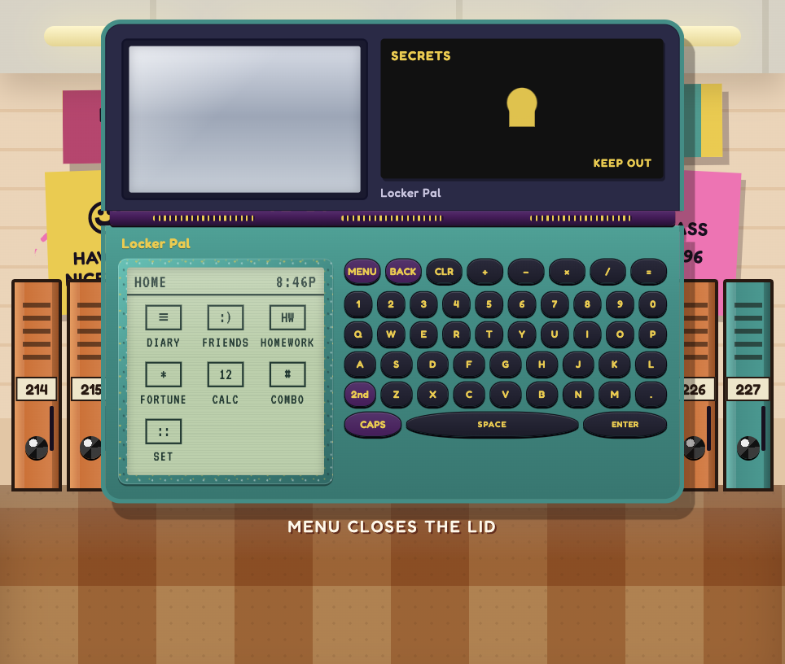

# Locker Pal

Locker Pal is a Pomodoro timer that also works like a real kids’ PDA from the 90s — clamshell lid, chunky keys, and a locker hallway behind it.

Tap the closed notebook to open it. That starts a 25-minute **FOCUS** timer. Press **EXIT** on the timer screen, or the **MENU** key, to get to Home and the rest of the organizer (diary, friends, homework, and a few other apps). **MENU** from Home closes the lid.

The sticker inside the lid quotes Emily Dickinson — [Forever is composed of Nows](https://www.poetryfoundation.org/poems/52202/forever-is-composed-of-nows-690).

## Run it

You need [Node.js](https://nodejs.org/). Then:

```bash
git clone <repository-url>
cd locker-pal
npm install
npm run dev
```

Open the address printed in the terminal (usually `http://localhost:5173`).

To run the tests:

```bash
npm test
```

## Screenshots

Closed lid:



FOCUS timer after you open it:



Home, once you leave the timer:


